# Unified Four-Stack `20 GiB` GCS Benchmark Summary & Architectural Report (`US-WEST4`, `Transport::Http`)

* **Author**: Antigravity & Prince Kumar (`@princer`)
* **Date**: 2026-11-06
* **Target Bucket & Object**: `gs://princer-flat/bench/bench_20GB.bin` (`20.00 GiB` / `21,474,836,480` bytes) and `bench_20GB_00.bin` .. `bench_20GB_47.bin` (`48 × 20 GiB = 960 GiB`) in `US-WEST4`
* **Reference Documents**:
  * Design & Benchmark Plan: [`docs/designs/four_stack_20gb_benchmark_plan.md`](file:///home/princer_google_com/c1dev/gcsfs/docs/designs/four_stack_20gb_benchmark_plan.md)
  * Native Rust Baseline Plan: [`four_way_benchmark_plan.md`](file:///home/princer_google_com/dev/gcs-rust-fs/docs/designs/four_way_benchmark_plan.md)
  * Native Rust Baseline Report: [`native_rust_fs_benchmark_report.md`](file:///home/princer_google_com/dev/gcs-rust-fs/docs/native_rust_fs_benchmark_report.md)
  * Raw JSON Dataset: [`benchmarks/results_four_stacks_20gb.json`](file:///home/princer_google_com/c1dev/gcsfs/benchmarks/results_four_stacks_20gb.json)

---

## 1. Master Executive Summary (All Stacks & Workloads at a Glance)

| Workload / Metric | Stack 1: Native Rust (`gcs-rust-fs` v0.1.1) | Scenario 1 (Stack 2): Pure Python `gcsfs` (`s1_python`) | Scenario 2 (Stack 3): Direct PyO3 `CachedFs<GcsFs>` (`s2_pyo3_direct`) | Scenario 3 (Stack 4a): Python `grpc.aio` → UDS Sidecar (`s3_uds_grpc_aio`) | Scenario 4 (Stack 4b): PyO3 `RemoteFs` → UDS Sidecar (`s4_pyo3_remotefs`) |
| :--- | :---: | :---: | :---: | :---: | :---: |
| **Execution Path** | Pure Rust (`CachedFs<GcsFs>`) | Python `fsspecIO` + `aiohttp` (`AdaptiveReadahead`) | In-Process PyO3 → Rust `CachedFs<GcsFs>` (Zero `fsspecIO`) | Python `grpc.aio` Loop → UDS → **1 Shared `gcsfs-sidecar`** (Zero `fsspecIO`) | In-Process PyO3 → Rust `RemoteFs` → UDS → **1 Shared `gcsfs-sidecar`** (Zero `fsspecIO`) |
| **Multi-Process (`24P` / `48P`) Topology** | `1` Process (`24T` / `48T` Rust threads sharing `Arc<CachedFs>`) | `24` / `48` Independent Python Procs (`1` `aiohttp` pool per proc) | `24` / `48` Independent Python Procs (`1` `CachedFs` per proc) | `24` / `48` Python Procs → **1 Shared `gcsfs-sidecar` UDS Server** | `24` / `48` Python Procs → **1 Shared `gcsfs-sidecar` UDS Server** |
| **`fsspecIO` Event Loop (`fs._loop`)** | N/A (Pure Rust) | Active (`1` loop thread/proc) | **Eliminated (`None`)** | **Eliminated (`None`)** | **Eliminated (`None`)** |
| **Part 1: Uncached `info()` `p50` (`30` iters)** | `28.38 ms` (`mean 28.38 ms`) | **`22.24 ms`** (`mean 22.52 ms`) | `25.95 ms` (`mean 26.21 ms`) | `25.71 ms` (`mean 26.22 ms`) | `26.64 ms` (`mean 27.06 ms`) |
| **Part 2: `1 MiB` Random Read (`1T`, `50` reads)** | `39.15 ms` `p50` (`23.90 IOPS`, `25.03 MB/s`) | `39.11 ms` `p50` (`25.70 IOPS`, `26.95 MB/s`)* | `44.43 ms` `p50` (`21.74 IOPS`, `22.80 MB/s`) | `48.64 ms` `p50` (`20.43 IOPS`, `21.42 MB/s`) | **`41.12 ms` `p50` (`24.10 IOPS`, `25.27 MB/s`)** |
| **Part 3: `20 GiB` Seq Read — `1` Worker (`20 GiB`)** | **`4,106.42 MB/s`** (`5.23 s`) | `774.43 MB/s` (`27.73 s`) | **`3,425.15 MB/s`** (`6.27 s`, **4.42x**) | `959.21 MB/s` (`22.39 s`, **1.24x**) | **`2,791.67 MB/s`** (`7.69 s`, **3.60x**) |
| **Part 3: `20 GiB` Seq Read — `24T` (`24` Threads, `480 GiB`)** | **`15,604.48 MB/s`** (`33.03 s`) | `655.74 MB/s` (`74.5 GiB` @ `122 s`†) | **`5,745.57 MB/s`** (`89.70 s`, **8.76x**) | `1,322.75 MB/s` (`148.1 GiB` @ `120 s`†, **2.02x**) | **`5,573.73 MB/s`** (`92.47 s`, **8.50x**) |
| **Part 3: `20 GiB` Seq Read — `24P` (`24` Procs, `480 GiB`)** | *(`15,604.48 MB/s` @ `24T`)* | `11,883.23 MB/s` (`43.37 s`) | **`17,107.49 MB/s`** (`30.13 s`, **1.44x**) | `10,167.10 MB/s` (`50.69 s`, `0.86x`) | **`18,598.15 MB/s`** (`27.71 s`, **1.57x**) |
| **Part 3: `20 GiB` Seq Read — `48T` (`48` Threads, `960 GiB`)** | **`20,976.12 MB/s`** (`49.14 s`) | `647.16 MB/s` (`75.0 GiB` @ `124 s`†) | **`5,567.89 MB/s`** (`622.8 GiB` @ `120 s`†, **8.60x**) | `1,300.95 MB/s` (`145.7 GiB` @ `120 s`†, **2.01x**) | **`5,369.23 MB/s`** (`600.5 GiB` @ `120 s`†, **8.30x**) |
| **Part 3: `20 GiB` Seq Read — `48P` (`48` Procs, `960 GiB`)** | *(`20,976.12 MB/s` @ `48T`)* | `16,631.72 MB/s` (`61.98 s`) | **`20,257.41 MB/s`** (`50.88 s`, **1.22x**) | `11,601.92 MB/s` (`88.85 s`, `0.70x`) | **`20,420.30 MB/s`** (`50.48 s`, **1.23x**) |
| **Part 4: `200 MiB` Streaming Write (`open("wb")`)** | `97.88 MB/s` (`2.140 s`) | `105.02 MB/s` (`1.997 s`) | `99.53 MB/s` (`2.107 s`) | `101.55 MB/s` (`2.065 s`) | `102.06 MB/s` (`2.055 s`) |
| **Part 4: `200 MiB` One-Shot Write (`pipe_file`)** | `156.46 MB/s` (`1.340 s`) | `148.97 MB/s` (`1.408 s`) | **`219.24 MB/s`** (`0.957 s`, **1.47x**) | `98.79 MB/s` (`2.123 s`) | `106.08 MB/s` (`1.977 s`) |

*\*With `cache_type="none"` (`5 MiB` default block fetch), `s1_python` Part 2 random read is `88.29 ms` `p50` (`10.32 IOPS`, `10.82 MB/s`); with `AdaptiveReadaheadCache` (`DEFAULT_CACHE_TYPE`), it fetches exact `1 MiB` slices at `39.11 ms` `p50` (`25.70 IOPS`, `26.95 MB/s`).*  
*†Indicates run stopped at the `120 s` per-test duration cap.*

---

## 2. Benchmark Environment & Architecture

### 2.1 Hardware & Software Specifications

| Component | Specification |
| :--- | :--- |
| **Compute Instance** | GCE `c4-standard-192` (`192` vCPUs, 2 sockets × Intel Xeon Platinum 8581C @ 2.30 GHz, 4 NUMA nodes) |
| **System Memory** | `708 GiB` RAM |
| **OS & Kernel** | Linux `7.0.0-1008-gcp` (`x86_64`) |
| **Runtimes & Compilers** | Python `3.14.4`, `rustc 1.97.1` (`--release`), `gcs-rust-fs` `v0.1.1` ([`/home/princer_google_com/dev/gcs-rust-fs`](file:///home/princer_google_com/dev/gcs-rust-fs)) |
| **Compute Zone & Bucket** | `us-west4-a` → `gs://princer-flat/bench/` (Regional bucket in `US-WEST4`, co-located with compute VM) |
| **Target Objects** | `bench_20GB.bin` (`20.00 GiB`) and `bench_20GB_00.bin` .. `bench_20GB_47.bin` (`48 × 20 GiB = 960 GiB`) |
| **Data Transport & Caching** | `Transport::Http` (HTTP/JSON), metadata `DirCache` disabled (`cache_timeout=0`), Mode 1 drop-behind readahead (`cache: None`, `ReadPattern::Auto`) |
| **UDS Sidecar Server (`Scenarios 3 & 4`)** | **Single shared `gcsfs-sidecar` daemon process** listening on `/tmp/gcsfs-sidecar-bench.sock` (`--transport http --http-pool-size 48 [--readahead]`), concurrently serving all `1`, `24T`, `24P`, `48T`, and `48P` client workers |

### 2.2 The Five Evaluated Stacks

```mermaid
flowchart LR
    subgraph S0["Stack 1: Native Rust Baseline"]
        N1["Rust Tokio Worker Threads (1T / 24T / 48T)"] -->|"CachedFs<GcsFs> Mode 1 (Auto)"| GCS0[("GCS HTTP/JSON")]
    end

    subgraph S1["Scenario 1 (Stack 2): Pure Python gcsfs"]
        P1["Python Workers (1 / 24T / 24P / 48T / 48P)"] -->|"asyn.sync()"| L1["fsspecIO Background Loop Thread"]
        L1 -->|"AdaptiveReadahead + aiohttp"| GCS1[("GCS HTTP/JSON")]
    end

    subgraph S2["Scenario 2 (Stack 3): Direct PyO3 CachedFs<GcsFs>"]
        P2["Python Workers (1 / 24T / 24P / 48T / 48P, fs._loop = None)"] -->|"py.detach() + block_on"| R2["In-Process Rust Tokio + CachedFs<GcsFs>"]
        R2 -->|"reqwest HTTP Pool"| GCS2[("GCS HTTP/JSON")]
    end

    subgraph S3["Scenario 3 (Stack 4a): Python grpc.aio -> 1 Shared UDS Sidecar"]
        P3["Python Workers (1 / 24T / 24P / 48T / 48P, fs._loop = None)"] -->|"run_coroutine_threadsafe"| G3["Per-PID Python grpc.aio + UdsGrpcFile"]
        G3 -->|"unix:///tmp/gcsfs-sidecar-bench.sock"| D3["1 Shared Rust gcsfs-sidecar Daemon"]
        D3 -->|"Shared CachedFs<GcsFs> + 48 HTTP Pool"| GCS3[("GCS HTTP/JSON")]
    end

    subgraph S4["Scenario 4 (Stack 4b): PyO3 RemoteFs -> 1 Shared UDS Sidecar"]
        P4["Python Workers (1 / 24T / 24P / 48T / 48P, fs._loop = None)"] -->|"py.detach() + block_on"| R4["Per-PID Rust RemoteFs + RemoteFile"]
        R4 -->|"unix:///tmp/gcsfs-sidecar-bench.sock"| D4["1 Shared Rust gcsfs-sidecar Daemon"]
        D4 -->|"Shared CachedFs<GcsFs> + 48 HTTP Pool"| GCS4[("GCS HTTP/JSON")]
    end
```



### 2.3 Implementation Summary & Codebase Links

1. **Upgraded PyO3 Bridge (`gcs_rust_fs_py` → `gcs-rust-fs v0.1.1`)**:
   * [`rust/gcs_rust_fs_py/Cargo.toml`](file:///home/princer_google_com/c1dev/gcsfs/rust/gcs_rust_fs_py/Cargo.toml) & [`rust/gcs_rust_fs_py/src/lib.rs`](file:///home/princer_google_com/c1dev/gcsfs/rust/gcs_rust_fs_py/src/lib.rs):
     * Added `RustBackend::Direct(Arc<CachedFs<GcsFs>>)` wrapping `GcsFs` in `CachedFs` with Mode 1 drop-behind readahead (`page_size = 256 KiB`, `io_size = 16 MiB`, `max_folio_size = 16 MiB`, configurable `GCS_RUST_FS_RA_MAX_READAHEAD_MB` and `GCS_RUST_FS_RA_MAX_INFLIGHT`, `cache = None`) and `http_pool_size = 48`.
     * Added `RustBackend::RemoteUds(Arc<RemoteFs>)` connecting to the shared `gcsfs-sidecar` daemon via `RemoteFs::connect_uds_with_pool_size(uds_path, 16)`.
     * Added `uncached` bypass on `info()` (`cached.inner().info(path).await` when `cache_timeout == 0`) and implemented `seek`, `tell`, `size`, and `info` on `RustGcsFile` with GIL release (`py.detach()`).
2. **Pure-Python `grpc.aio` UDS Client (`Scenario 3`)**:
   * [`gcsfs/_proto/filesystem_pb2.py`](file:///home/princer_google_com/c1dev/gcsfs/gcsfs/_proto/filesystem_pb2.py), [`gcsfs/_proto/filesystem_pb2_grpc.py`](file:///home/princer_google_com/c1dev/gcsfs/gcsfs/_proto/filesystem_pb2_grpc.py), and [`gcsfs/uds_grpc_backend.py`](file:///home/princer_google_com/c1dev/gcsfs/gcsfs/uds_grpc_backend.py):
     * Implemented fork-safe per-PID background `asyncio` event loop (`_PidLoopPool`) and pooled `grpc.aio.insecure_channel("unix://...")` channels with `("grpc.default_authority", "localhost")` and `16 MiB` message/window limits.
     * Implemented stream-bound [`UdsGrpcFile`](file:///home/princer_google_com/c1dev/gcsfs/gcsfs/uds_grpc_backend.py#L296-L565): sequential `read()` calls reuse a single open `stub.Read` stream (`range=[pos, file_size)`), while `seek(offset)` + `read(1 MiB)` issues a bounded single-range `ReadRequest(range=[pos, pos + len))` to trigger the sidecar's `cat_file` fast path without speculative readahead amplification.
3. **Eliminating the `fsspecIO` Event Loop in `gcsfs` (`fs._loop is None`)**:
   * [`gcsfs/core.py`](file:///home/princer_google_com/c1dev/gcsfs/gcsfs/core.py), [`gcsfs/extended_gcsfs.py`](file:///home/princer_google_com/c1dev/gcsfs/gcsfs/extended_gcsfs.py), and [`gcsfs/rust_backend.py`](file:///home/princer_google_com/c1dev/gcsfs/gcsfs/rust_backend.py):
     * Bypassed `fsspec.asyn.get_loop()` during `GCSFileSystem.__init__` when `use_rust_fs=True` or `use_uds_grpc=True` so `fs._loop` remains `None` and no `fsspecIO` thread is spawned.
     * Overrode synchronous `info()`, `cat_file()`, `pipe_file()`, and `ExtendedGcsFileSystem._open()` to call `rust_*_sync` / `uds_*_sync` and `GCSFile` directly on the caller thread without `asyn.sync_wrapper`.
     * Preloaded file metadata from `RustGcsFile.info()` / `UdsGrpcFile.info()` in `GCSFile.__init__` to eliminate duplicate `info()` RPCs on `fs.open(path, "rb")`.
4. **Integration Tests & 4-Stack Benchmark Runner**:
   * [`gcsfs/tests/test_gcs_rust_fs_poc.py`](file:///home/princer_google_com/c1dev/gcsfs/gcsfs/tests/test_gcs_rust_fs_poc.py): All 25 integration tests pass (including `assert fs._loop is None` and live `gcsfs-sidecar` verification for Scenarios 3 and 4).
   * [`benchmarks/bench_four_stacks_20gb.py`](file:///home/princer_google_com/c1dev/gcsfs/benchmarks/bench_four_stacks_20gb.py): Automated benchmark harness managing the single shared `gcsfs-sidecar` daemon lifecycle (`SidecarManager`), thread/process barriers, `--max-duration-secs 120` cap, and JSON output.

---

## 3. Detailed Benchmark Results by Workload

### 3.1 Part 1: Single-Worker Uncached Metadata `info()` Latency (`1T`, `30` Iterations)

All client-side and sidecar metadata caches are disabled (`cache_timeout=0`; `gcsfs-sidecar` started without `--cache` or `--readahead` during Part 1).

| Stack / Scenario | Workers | Iterations | Mean (`ms`) | Min (`ms`) | `p50` (`ms`) | `p90` (`ms`) | `p99` (`ms`) | Max (`ms`) |
| :--- | :---: | :---: | :---: | :---: | :---: | :---: | :---: | :---: |
| **Stack 1: Native Rust (`GcsFs::info`)** | `1T` | `30` | `28.38` | `23.21` | `28.38` | `31.00` | `38.53` | — |
| **Scenario 1 (`s1_python`): Pure Python `gcsfs`** | `1T` | `30` | `22.52` | `16.18` | **`22.24`** | `25.70` | `32.22` | `34.57` |
| **Scenario 2 (`s2_pyo3_direct`): Direct PyO3 `CachedFs<GcsFs>`** | `1T` | `30` | `26.21` | `19.02` | **`25.95`** | `32.43` | `34.94` | `35.47` |
| **Scenario 3 (`s3_uds_grpc_aio`): Python `grpc.aio` → UDS Sidecar** | `1T` | `30` | `26.22` | `17.84` | **`25.71`** | `33.60` | `36.44` | `37.36` |
| **Scenario 4 (`s4_pyo3_remotefs`): PyO3 `RemoteFs` → UDS Sidecar** | `1T` | `30` | `27.06` | `20.47` | **`26.64`** | `31.66` | `32.54` | `32.56` |

---

### 3.2 Part 2: Single-Worker `1 MiB` Random Read (`1T`, `50` Reads)

50 deterministic `SplitMix64` non-overlapping `4 MiB`-aligned offsets across the `20 GiB` object (`50 MiB` total data read via `open("rb")` + `seek(offset)` + `read(1 MiB)`).

| Stack / Scenario | Workers | Reads (`Total`) | Wall Time (`s`) | `p50` (`ms`) | `p90` (`ms`) | `p99` (`ms`) | IOPS | Throughput (`MB/s` / `MiB/s`) |
| :--- | :---: | :---: | :---: | :---: | :---: | :---: | :---: | :---: |
| **Stack 1: Native Rust (`CachedFs` Mode 1 `Auto`)** | `1T` | `50` (`50 MiB`) | `2.092` | `39.15` | `53.03` | `128.24` | `23.90` | `25.03 MB/s` (`23.87 MiB/s`) |
| **Scenario 1 (`s1_python`): Pure Python `gcsfs` (`AdaptiveReadahead`)** | `1T` | `50` (`50 MiB`) | `1.946` | `39.11` | `44.83` | `54.71` | `25.70` | `26.95 MB/s` (`25.70 MiB/s`) |
| **Scenario 1 (`s1_python`): Pure Python `gcsfs` (`cache_type="none"`)** | `1T` | `50` (`50 MiB`) | `4.845` | `88.29` | `148.41` | `218.59` | `10.32` | `10.82 MB/s` (`10.32 MiB/s`) |
| **Scenario 2 (`s2_pyo3_direct`): Direct PyO3 `CachedFs<GcsFs>`** | `1T` | `50` (`50 MiB`) | `2.300` | `44.43` | `56.46` | `81.46` | `21.74` | `22.80 MB/s` (`21.74 MiB/s`) |
| **Scenario 3 (`s3_uds_grpc_aio`): Python `grpc.aio` → UDS Sidecar** | `1T` | `50` (`50 MiB`) | `2.448` | `48.64` | `58.25` | `68.53` | `20.43` | `21.42 MB/s` (`20.43 MiB/s`) |
| **Scenario 4 (`s4_pyo3_remotefs`): PyO3 `RemoteFs` → UDS Sidecar** | `1T` | `50` (`50 MiB`) | `2.075` | **`41.12`** | **`49.19`** | **`54.73`** | **`24.10`** | **`25.27 MB/s` (`24.10 MiB/s`)** |

---

### 3.3 Part 3: Full-File `20 GiB` Sequential Read (`8 MiB` Chunks — `1`, `24T`, `24P`, `48T`, `48P`)

Each worker streams its own distinct `20 GiB` object (`bench_20GB_00.bin` .. `bench_20GB_47.bin`) in `8 MiB` chunks after a post-`open()` readiness barrier:
* **`1` Worker**: `1 × 20 GiB = 20 GiB`
* **`24T` (`24` Threads in 1 Process)** & **`24P` (`24` Spawned Processes)**: `24 × 20 GiB = 480 GiB`
* **`48T` (`48` Threads in 1 Process)** & **`48P` (`48` Spawned Processes)**: `48 × 20 GiB = 960 GiB`
* **Single Shared UDS Server in `24P` & `48P` (`Scenarios 3 & 4`)**: In `24P` and `48P`, all `24` or `48` spawned Python worker processes connect concurrently to **one single `gcsfs-sidecar` UDS server process** (`/tmp/gcsfs-sidecar-bench.sock`), sharing its centralized `CachedFs<GcsFs>` readahead engine and 48-connection GCS HTTP pool.
* **Duration Cap**: `--max-duration-secs 120` (`2` minutes per test).

| Concurrency | Stack / Scenario | Data Read / Target | Wall Time (`s`) | Chunk `p50` (`ms`) | Chunk `p90` (`ms`) | Throughput (`MB/s`) | Throughput (`MiB/s`) | Speedup vs. `s1_python` | % of Native Rust |
| :---: | :--- | :---: | :---: | :---: | :---: | :---: | :---: | :---: | :---: |
| **`1`** | **Stack 1: Native Rust (`1T`)** | `20.0 / 20 GiB` | `5.23` | `0.00` | `0.11` | **`4,106.42`** | **`3,916.18`** | `5.30x` | `100.0%` |
| **`1`** | **Scenario 1 (`s1_python`)** | `20.0 / 20 GiB` | `27.73` | `6.56` | `20.56` | `774.43` | `738.56` | `1.00x` | `18.9%` |
| **`1`** | **Scenario 2 (`s2_pyo3_direct`)** | `20.0 / 20 GiB` | **`6.27`** | `1.05` | `3.93` | **`3,425.15`** | **`3,266.48`** | **`4.42x`** | **`83.4%`** |
| **`1`** | **Scenario 3 (`s3_uds_grpc_aio`)** | `20.0 / 20 GiB` | `22.39` | `6.67` | `16.13` | `959.21` | `914.77` | `1.24x` | `23.4%` |
| **`1`** | **Scenario 4 (`s4_pyo3_remotefs`)** | `20.0 / 20 GiB` | **`7.69`** | `2.21` | `4.89` | **`2,791.67`** | **`2,662.35`** | **`3.60x`** | **`68.0%`** |
| **`24T`** | **Stack 1: Native Rust (`24T`)** | `480.0 / 480 GiB` | `33.03` | `0.00` | `49.88` | **`15,604.48`** | **`14,881.59`** | `23.80x` | `100.0%` |
| **`24T`** | **Scenario 1 (`s1_python`)** | `74.5 / 480 GiB` (cap) | `122.01` | `73.59` | `820.89` | `655.74` | `625.37` | `1.00x` | `4.2%` |
| **`24T`** | **Scenario 2 (`s2_pyo3_direct`)** | `480.0 / 480 GiB` | `89.70` | `1.42` | `117.08` | **`5,745.57`** | **`5,479.40`** | **`8.76x`** | `36.8%` |
| **`24T`** | **Scenario 3 (`s3_uds_grpc_aio`)** | `148.1 / 480 GiB` (cap) | `120.20` | `144.21` | `187.63` | `1,322.75` | `1,261.47` | `2.02x` | `8.5%` |
| **`24T`** | **Scenario 4 (`s4_pyo3_remotefs`)** | `480.0 / 480 GiB` | `92.47` | `18.67` | `88.62` | **`5,573.73`** | **`5,315.52`** | **`8.50x`** | `35.7%` |
| **`24P`** | **Scenario 1 (`s1_python`)** | `480.0 / 480 GiB` | `43.37` | `4.13` | `36.64` | `11,883.23` | `11,332.73` | `1.00x` | `76.2%` |
| **`24P`** | **Scenario 2 (`s2_pyo3_direct`)** | `480.0 / 480 GiB` | `30.13` | `2.07` | `38.03` | **`17,107.49`** | **`16,314.97`** | **`1.44x`** | **`109.6%`** |
| **`24P`** | **Scenario 3 (`s3_uds_grpc_aio`, 1 shared sidecar)** | `480.0 / 480 GiB` | `50.69` | `14.28` | `32.32` | `10,167.10` | `9,696.10` | `0.86x` | `65.2%` |
| **`24P`** | **Scenario 4 (`s4_pyo3_remotefs`, 1 shared sidecar)** | `480.0 / 480 GiB` | **`27.71`** | `9.51` | `14.10` | **`18,598.15`** | **`17,736.58`** | **`1.57x`** | **`119.2%`** |
| **`48T`** | **Stack 1: Native Rust (`48T`)** | `960.0 / 960 GiB` | `49.14` | `0.00` | `75.63` | **`20,976.12`** | **`20,004.39`** | `32.41x` | `100.0%` |
| **`48T`** | **Scenario 1 (`s1_python`)** | `75.0 / 960 GiB` (cap) | `124.50` | `71.57` | `1004.34` | `647.16` | `617.18` | `1.00x` | `3.1%` |
| **`48T`** | **Scenario 2 (`s2_pyo3_direct`)** | `622.8 / 960 GiB` (cap) | `120.11` | `1.54` | `249.95` | **`5,567.89`** | **`5,309.96`** | **`8.60x`** | `26.5%` |
| **`48T`** | **Scenario 3 (`s3_uds_grpc_aio`)** | `145.7 / 960 GiB` (cap) | `120.26` | `294.05` | `412.94` | `1,300.95` | `1,240.68` | `2.01x` | `6.2%` |
| **`48T`** | **Scenario 4 (`s4_pyo3_remotefs`)** | `600.5 / 960 GiB` (cap) | `120.09` | `28.98` | `206.05` | **`5,369.23`** | **`5,120.50`** | **`8.30x`** | `25.6%` |
| **`48P`** | **Scenario 1 (`s1_python`)** | `960.0 / 960 GiB` | `61.98` | `1.81` | `72.59` | `16,631.72` | `15,861.24` | `1.00x` | `79.3%` |
| **`48P`** | **Scenario 2 (`s2_pyo3_direct`)** | `960.0 / 960 GiB` | `50.88` | `2.35` | `61.74` | **`20,257.41`** | **`19,318.97`** | **`1.22x`** | **`96.6%`** |
| **`48P`** | **Scenario 3 (`s3_uds_grpc_aio`, 1 shared sidecar)** | `960.0 / 960 GiB` | `88.85` | `22.22` | `53.07` | `11,601.92` | `11,064.45` | `0.70x` | `55.3%` |
| **`48P`** | **Scenario 4 (`s4_pyo3_remotefs`, 1 shared sidecar)** | `960.0 / 960 GiB` | **`50.48`** | `18.23` | `23.23` | **`20,420.30`** | **`19,474.32`** | **`1.23x`** | **`97.4%`** |

---

### 3.4 Part 4: Single-Worker `200 MiB` Write (`1T`, `5` Iterations)

Compares streaming writes (`open("wb")` + `25 × write(8 MiB)` + `close()`) vs. one-shot `pipe_file(200 MiB)` to `gs://princer-flat/bench/bench_20GB_write_200MB.bin`.

| Stack / Scenario | Streaming `open("wb")` Mean (`s`) | Streaming `p50` (`s`) | Streaming `p90` (`s`) | Streaming Throughput (`MB/s` / `MiB/s`) | One-Shot `pipe_file` Mean (`s`) | `pipe_file` `p50` (`s`) | `pipe_file` `p90` (`s`) | `pipe_file` Throughput (`MB/s` / `MiB/s`) |
| :--- | :---: | :---: | :---: | :---: | :---: | :---: | :---: | :---: |
| **Stack 1: Native Rust (`CachedFs<GcsFs>`)** | `2.140` | `2.140` | `2.170` | `97.88 MB/s` (`93.34 MiB/s`) | `1.340` | `1.340` | `1.710` | `156.46 MB/s` (`149.21 MiB/s`) |
| **Scenario 1 (`s1_python`): Pure Python `gcsfs`** | `1.997` | `1.997` | `2.075` | `105.02 MB/s` (`100.16 MiB/s`) | `1.386` | `1.408` | `1.486` | `148.97 MB/s` (`142.07 MiB/s`) |
| **Scenario 2 (`s2_pyo3_direct`): Direct PyO3 `CachedFs<GcsFs>`** | `2.132` | `2.107` | `2.186` | `99.53 MB/s` (`94.92 MiB/s`) | **`1.006`** | **`0.957`** | **`1.109`** | **`219.24 MB/s` (`209.08 MiB/s`)** |
| **Scenario 3 (`s3_uds_grpc_aio`): Python `grpc.aio` → UDS Sidecar** | `2.077` | `2.065` | `2.175` | `101.55 MB/s` (`96.84 MiB/s`) | `2.094` | `2.123` | `2.131` | `98.79 MB/s` (`94.22 MiB/s`) |
| **Scenario 4 (`s4_pyo3_remotefs`): PyO3 `RemoteFs` → UDS Sidecar** | `2.060` | `2.055` | `2.129` | `102.06 MB/s` (`97.33 MiB/s`) | `1.981` | `1.977` | `2.043` | `106.08 MB/s` (`101.17 MiB/s`) |

---

## 4. Deep-Dive Architectural Analysis & Key Takeaways

### 4.1 Impact of Eliminating the `fsspecIO` Event Loop (`3.43 GB/s` vs. `774 MB/s` at `1` Worker)
In standard `gcsfs` (`Scenario 1`), every synchronous `read()`, `info()`, or `cat_file()` call submits a coroutine via `asyncio.run_coroutine_threadsafe` to a single background `fsspecIO` Python thread.
* By bypassing `fsspec.asyn.get_loop()` (`fs._loop is None`) and invoking `RustGcsFile.read()` directly from the caller thread with `py.detach()`, **Scenario 2 (`s2_pyo3_direct`)** reaches **`3,425.15 MB/s` (`6.27 s`)** on a single `20 GiB` file — a **`4.42x` speedup** over Pure Python `gcsfs` (`774.43 MB/s`, `27.73 s`), and **83.4% of Native Rust (`4,106.42 MB/s`, `5.23 s`)**.
* The remaining `1.04 s` difference between Native Rust (`5.23 s`) and Direct PyO3 (`6.27 s`) for `20 GiB` corresponds to `~19 GB/s` of memory bandwidth required by `PyBytes::new(py, &data)` to allocate and copy `20 GiB` into Python `bytes` objects.

### 4.2 Why Multi-Threading (`24T` / `48T`) Hits a Ceiling While Multi-Processing (`24P` / `48P`) Saturates the `20 GB/s` NIC
* **Single-Process Multi-Threading (`24T` / `48T`)**:
  * **Scenario 1 (`s1_python`)** drops from `774.43 MB/s` (`1` worker) to `655.74 MB/s` (`24T`) and `647.16 MB/s` (`48T`) because all 24/48 threads multiplex their HTTP/TLS reads and `AdaptiveReadaheadCache` coroutines onto **one `fsspecIO` Python thread**.
  * **Scenario 3 (`s3_uds_grpc_aio`)** tops out at `1,322.75 MB/s` (`24T`) and `1,300.95 MB/s` (`48T`) because all 24/48 `grpc.aio` streams share **one background `asyncio` event-loop thread**.
  * **Scenarios 2 & 4 (`s2_pyo3_direct` & `s4_pyo3_remotefs`)** execute all HTTP/UDS I/O and readahead on Rust Tokio worker threads with the GIL released (`py.detach()`), achieving **`5,745.57 MB/s` (`24T`)** and **`5,573.73 MB/s` (`24T`)** (**`8.5x–8.8x` faster** than `s1_python`). At `~5.7 GB/s` inside a single Python process, the bottleneck is purely the single-process Python GIL during `PyBytes::new(py, &data)` (`8 MiB` allocation + `memcpy` while holding the GIL).
* **Multi-Processing (`24P` / `48P` — Idiomatic Python / PyTorch `DataLoader` Concurrency)**:
  * With one GIL per worker process, both Rust-backed architectures scale to full host NIC saturation:
  * **Scenario 2 (`s2_pyo3_direct`)** reaches **`17,107.49 MB/s` (`30.13 s`)** at `24P` and **`20,257.41 MB/s` (`50.88 s`)** at `48P`.
  * **Scenario 4 (`s4_pyo3_remotefs`)** reaches **`18,598.15 MB/s` (`27.71 s`)** at `24P` and **`20,420.30 MB/s` (`50.48 s`)** at `48P` (**97.4% of Native Rust `48T`**), with all 24/48 Python processes multiplexed into **one shared `gcsfs-sidecar` UDS server process**.

### 4.3 Scenario 3 (`Python grpc.aio` over UDS) vs. Scenario 4 (`PyO3 RemoteFs` over UDS)
Both Scenario 3 and Scenario 4 communicate with the **exact same single `gcsfs-sidecar` daemon** over `/tmp/gcsfs-sidecar-bench.sock`, yet Scenario 4 outperforms Scenario 3 across every workload:
* **`1` Worker Seq Read**: `2,791.67 MB/s` vs. `959.21 MB/s` (**`2.91x` faster**)
* **`24T` Seq Read**: `5,573.73 MB/s` vs. `1,322.75 MB/s` (**`4.21x` faster**)
* **`24P` Seq Read**: `18,598.15 MB/s` vs. `10,167.10 MB/s` (**`1.83x` faster**)
* **`48P` Seq Read**: `20,420.30 MB/s` vs. `11,601.92 MB/s` (**`1.76x` faster**)
* **`1 MiB` Random Read**: `24.10 IOPS` (`41.12 ms` `p50`) vs. `20.43 IOPS` (`48.64 ms` `p50`) (**`1.18x` faster**)

**Root Cause**: In Scenario 3 (`grpc.aio`), every `ReadResponse` frame requires waking the Python `asyncio` loop, deserializing a Python protobuf message object, and slicing `bytes` in Python. In Scenario 4 (`PyO3 RemoteFs`), Tonic HTTP/2 frame reassembly and `prost` protobuf decoding happen entirely in Rust across Tokio threads while the GIL is released (`py.detach()`), using zero-copy `bytes::Bytes::split_to` before handing the final `8 MiB` buffer to Python.

### 4.4 Scenario 2 (`Direct PyO3`) vs. Scenario 4 (`PyO3 RemoteFs` over Single Shared UDS Sidecar)
* **Single-Process (`1` Worker)**: Scenario 2 (`Direct PyO3`) is faster (`3,425.15 MB/s` vs. `2,791.67 MB/s`, and `219.24 MB/s` vs. `106.08 MB/s` on `pipe_file`) because it avoids the UDS socket copy between `gcsfs-sidecar` and the Python process.
* **Multi-Process (`24P` / `48P`)**: Scenario 4 (`PyO3 RemoteFs` over a single shared UDS sidecar) matches or exceeds Scenario 2 (`18,598.15 MB/s` vs. `17,107.49 MB/s` at `24P`, and `20,420.30 MB/s` vs. `20,257.41 MB/s` at `48P`) because:
  1. All 24/48 Python worker processes share the single `gcsfs-sidecar` process's **already-warm 48-connection GCS HTTP/TLS pool** and **centralized `4 GiB` in-flight readahead semaphore**, avoiding 48× redundant OAuth2/TLS connection pool ramp-ups across spawned workers.
  2. Each Python worker process only maintains lightweight local UDS channels (`RemoteFs`), keeping per-worker memory footprint minimal and enabling **Mode 2 shared page caching (`--page-cache-mb`)** across worker processes.

---

## 5. Reproducing the Benchmarks

```bash
# 1. Build the PyO3 extension (gcs-rust-fs v0.1.1)
.venv/bin/maturin develop --release --manifest-path rust/gcs_rust_fs_py/Cargo.toml

# 2. Build the Rust UDS sidecar daemon
cargo build --release --manifest-path /home/princer_google_com/dev/gcs-rust-fs/Cargo.toml --bin gcsfs-sidecar

# 3. Run the 25 integration tests (Scenarios 1-4 + zero-fsspecIO check)
STORAGE_EMULATOR_HOST=https://storage.googleapis.com GCSFS_TEST_BUCKET=princer-flat \
  .venv/bin/pytest gcsfs/tests/test_gcs_rust_fs_poc.py -v

# 4. Run Parts 1, 2, and 4 across all 4 Python scenarios
.venv/bin/python benchmarks/bench_four_stacks_20gb.py \
  --parts 1,2,4 --json-out benchmarks/results_four_stacks_20gb.json

# 5. Run Part 3 (1, 24T, 24P, 48T, 48P) per scenario in isolated processes
for sc in s1_python s2_pyo3_direct s3_uds_grpc_aio s4_pyo3_remotefs; do
  .venv/bin/python benchmarks/bench_four_stacks_20gb.py \
    --scenarios "$sc" --parts 3 --concurrencies 1,24T,24P,48T,48P \
    --max-duration-secs 120 --json-out benchmarks/results_four_stacks_20gb.json
done
```
