# Unified Four-Stack `20 GiB` GCS Benchmark Summary & Architectural Report (`US-WEST4`, `Transport::Http`)

* **Author**: Antigravity & Prince Kumar (`@princer`)
* **Date**: 2026-11-11
* **Target Bucket & Object**: `gs://princer-flat/bench/bench_20GB.bin` (`20.00 GiB` / `21,474,836,480` bytes) and `bench_20GB_00.bin` .. `bench_20GB_47.bin` (`48 × 20 GiB = 960 GiB`) in `US-WEST4`
* **Reference Documents**:
  * Design & Benchmark Plan: [`docs/designs/four_stack_20gb_benchmark_plan.md`](file:///home/princer_google_com/c1dev/gcsfs/docs/designs/four_stack_20gb_benchmark_plan.md)
  * Native Rust Baseline Plan: [`four_way_benchmark_plan.md`](file:///home/princer_google_com/dev/gcs-rust-fs/docs/designs/four_way_benchmark_plan.md)
  * Native Rust Baseline Report: [`native_rust_fs_benchmark_report.md`](file:///home/princer_google_com/dev/gcs-rust-fs/docs/native_rust_fs_benchmark_report.md)
  * Raw JSON Dataset (with CPU & RSS): [`benchmarks/results_four_stacks_20gb.json`](file:///home/princer_google_com/c1dev/gcsfs/benchmarks/results_four_stacks_20gb.json)

---

## 1. Master Executive Summary (Throughput, Latency, CPU & Memory at a Glance)

> [!NOTE]
> **Resource Accounting Convention**:
> * **Avg CPU**: `100% = 1.0 vCPU core` (`utime + stime` from `/proc/<pid>/stat` sampled every `20–50 ms`).
> * **Memory RSS (`Avg / Peak`)**: Resident Set Size (`VmRSS` from `/proc/<pid>/status`) summed across all active client worker processes plus the shared `gcsfs-sidecar` daemon (for Scenarios 3 & 4, formatted as `Total [Client + Sidecar]`).

| Workload / Metric | Stack 1: Native Rust (`gcs-rust-fs` v0.1.1) | Scenario 1 (Stack 2): Pure Python `gcsfs` (`s1_python`) | Scenario 2 (Stack 3): Direct PyO3 `CachedFs<GcsFs>` (`s2_pyo3_direct`) | Scenario 3 (Stack 4a): Python `grpc.aio` → UDS Sidecar (`s3_uds_grpc_aio`) | Scenario 4 (Stack 4b): PyO3 `RemoteFs` → UDS Sidecar (`s4_pyo3_remotefs`) |
| :--- | :---: | :---: | :---: | :---: | :---: |
| **Execution Path** | Pure Rust (`CachedFs<GcsFs>`) | Python `fsspecIO` + `aiohttp` (`AdaptiveReadahead`) | In-Process PyO3 → Rust `CachedFs<GcsFs>` (Zero `fsspecIO`) | Python `grpc.aio` Loop → UDS → **1 Shared `gcsfs-sidecar`** (Zero `fsspecIO`) | In-Process PyO3 → Rust `RemoteFs` → UDS → **1 Shared `gcsfs-sidecar`** (Zero `fsspecIO`) |
| **Multi-Process (`24P` / `48P`) Topology** | `1` Process (`24T` / `48T` Rust threads sharing `Arc<CachedFs>`) | `24` / `48` Independent Python Procs (`1` `aiohttp` pool per proc) | `24` / `48` Independent Python Procs (`1` `CachedFs` per proc) | `24` / `48` Python Procs → **1 Shared `gcsfs-sidecar` UDS Server** | `24` / `48` Python Procs → **1 Shared `gcsfs-sidecar` UDS Server** |
| **`fsspecIO` Event Loop (`fs._loop`)** | N/A (Pure Rust) | Active (`1` loop thread/proc) | **Eliminated (`None`)** | **Eliminated (`None`)** | **Eliminated (`None`)** |
| **Part 1: Uncached `info()` `p50` (`30` iters)** | `28.38 ms` (`0.01c`, `45 MiB`) | **`22.24 ms`** (`0.08c`, `104 MiB`) | `25.95 ms` (`0.01c`, `138 MiB`) | `25.71 ms` (`0.08c`, `179 MiB` [`140+40`]) | `26.64 ms` (`0.04c`, `180 MiB` [`140+40`]) |
| **Part 2: `1 MiB` Random Read (`1T`, `50` reads)** | `39.15 ms` `p50` (`25.03 MB/s`, `0.21c`, `116 MiB`) | `39.11 ms` `p50` (`26.95 MB/s`*, `0.06c`, `144 MiB`) | `44.43 ms` `p50` (`22.80 MB/s`, `0.09c`, `161 MiB`) | `48.64 ms` `p50` (`21.42 MB/s`, `0.15c`, `237 MiB` [`181+56`]) | **`41.12 ms` `p50` (`25.27 MB/s`, `0.09c`, `243 MiB` [`184+59`])** |
| **Part 3: `20 GiB` Seq Read — `1` Worker (`20 GiB`)** | **`4,106.42 MB/s`** (`5.23 s`)<br/>CPU: `6.30c` \| Peak RSS: `1.32 GiB` | `774.43 MB/s` (`27.73 s`)<br/>CPU: `0.96c` \| Peak RSS: `0.42 GiB` | **`3,425.15 MB/s`** (`6.27 s`, **4.42x**)<br/>CPU: `6.42c` \| Peak RSS: `1.36 GiB` | `959.21 MB/s` (`22.39 s`, **1.24x**)<br/>CPU: `4.16c` [`1.64+2.51`]<br/>Peak RSS: `2.17 GiB` [`0.41+1.79`] | **`2,791.67 MB/s`** (`7.69 s`, **3.60x**)<br/>CPU: `6.23c` [`0.98+5.24`]<br/>Peak RSS: `1.88 GiB` [`0.18+1.70`] |
| **Part 3: `20 GiB` Seq Read — `24T` (`24` Threads, `480 GiB`)** | **`15,604.48 MB/s`** (`33.03 s`)<br/>CPU: `27.51c` \| Peak RSS: `5.13 GiB` | `655.74 MB/s` (`74.5 GiB` @ `122 s`†)<br/>CPU: **`1.01c`** \| Peak RSS: `2.63 GiB` | **`5,745.57 MB/s`** (`89.70 s`, **8.76x**)<br/>CPU: `8.03c` \| Peak RSS: `16.10 GiB` | `1,322.75 MB/s` (`148.1 GiB` @ `120 s`†)<br/>CPU: `18.24c` [`2.01+16.23`]<br/>Peak RSS: `27.15 GiB` [`2.56+24.71`] | **`5,573.73 MB/s`** (`92.47 s`, **8.50x**)<br/>CPU: `24.33c` [`4.74+19.59`]<br/>Peak RSS: `33.72 GiB` [`1.99+31.76`] |
| **Part 3: `20 GiB` Seq Read — `24P` (`24` Procs, `480 GiB`)** | *(`15,604.48 MB/s` @ `24T`)*<br/>*CPU: `27.51c` \| Peak RSS: `5.13 GiB`* | `11,883.23 MB/s` (`43.37 s`)<br/>CPU: `22.55c` \| Peak RSS: `8.33 GiB` | **`17,107.49 MB/s`** (`30.13 s`, **1.44x**)<br/>CPU: `42.09c` \| Peak RSS: **`7.07 GiB`** | `10,167.10 MB/s` (`50.69 s`, `0.86x`)<br/>CPU: `91.44c` [`37.46+53.98`]<br/>Peak RSS: `43.12 GiB` [`9.44+33.77`] | **`18,598.15 MB/s`** (`27.71 s`, **1.57x**)<br/>CPU: `106.81c` [`25.62+81.19`]<br/>Peak RSS: `35.93 GiB` [**`4.49` client**`+31.50`] |
| **Part 3: `20 GiB` Seq Read — `48T` (`48` Threads, `960 GiB`)** | **`20,976.12 MB/s`** (`49.14 s`)<br/>CPU: `30.79c` \| Peak RSS: `13.12 GiB` | `647.16 MB/s` (`75.0 GiB` @ `124 s`†)<br/>CPU: **`1.01c`** \| Peak RSS: `3.28 GiB` | **`5,567.89 MB/s`** (`622.8 GiB` @ `120 s`†)<br/>CPU: `8.26c` \| Peak RSS: `24.17 GiB` | `1,300.95 MB/s` (`145.7 GiB` @ `120 s`†)<br/>CPU: `17.42c` [`2.16+15.26`]<br/>Peak RSS: `47.25 GiB` [`4.47+42.92`] | **`5,369.23 MB/s`** (`600.5 GiB` @ `120 s`†)<br/>CPU: `28.91c` [`4.45+24.46`]<br/>Peak RSS: `56.59 GiB` [`3.62+52.97`] |
| **Part 3: `20 GiB` Seq Read — `48P` (`48` Procs, `960 GiB`)** | *(`20,976.12 MB/s` @ `48T`)*<br/>*CPU: `30.79c` \| Peak RSS: `13.12 GiB`* | `16,631.72 MB/s` (`61.98 s`)<br/>CPU: `43.98c` \| Peak RSS: `15.59 GiB` | **`20,257.41 MB/s`** (`50.88 s`, **1.22x**)<br/>CPU: `59.60c` \| Peak RSS: **`14.56 GiB`** | `11,601.92 MB/s` (`88.85 s`, `0.70x`)<br/>CPU: `144.58c` [`67.29+77.29`]<br/>Peak RSS: `75.17 GiB` [`17.23+57.95`] | **`20,420.30 MB/s`** (`50.48 s`, **1.23x**)<br/>CPU: `142.03c` [`48.10+93.93`]<br/>Peak RSS: `61.83 GiB` [**`8.57` client**`+53.31`] |
| **Part 4: `200 MiB` Streaming Write (`open("wb")`)** | `97.88 MB/s` (`2.140 s`)<br/>`0.04c` \| `303 MiB` | `105.02 MB/s` (`1.997 s`)<br/>`0.06c` \| `604 MiB` | `99.53 MB/s` (`2.107 s`)<br/>`0.07c` \| `638 MiB` | `101.55 MB/s` (`2.065 s`)<br/>`0.28c` \| `896 MiB` [`734+188`] | `102.06 MB/s` (`2.055 s`)<br/>`0.17c` \| `979 MiB` [`746+233`] |
| **Part 4: `200 MiB` One-Shot Write (`pipe_file`)** | `156.46 MB/s` (`1.340 s`)<br/>`0.05c` \| `303 MiB` | `148.97 MB/s` (`1.408 s`)<br/>`0.13c` \| `696 MiB` | **`219.24 MB/s`** (`0.957 s`, **1.47x**)<br/>`0.09c` \| `638 MiB` | `98.79 MB/s` (`2.123 s`)<br/>`0.25c` \| `891 MiB` [`708+183`] | `106.08 MB/s` (`1.977 s`)<br/>`0.13c` \| `995 MiB` [`754+241`] |

*\*With `cache_type="none"` (`5 MiB` default block fetch), `s1_python` Part 2 random read is `88.29 ms` `p50` (`10.32 IOPS`, `10.82 MB/s`); with `AdaptiveReadaheadCache` (`DEFAULT_CACHE_TYPE`), it fetches exact `1 MiB` slices at `39.11 ms` `p50` (`25.70 IOPS`, `26.95 MB/s`).*  
*†Indicates run stopped at the `120 s` per-test duration cap.*

---

## 2. Benchmark Environment & Architecture

### 2.1 Hardware & Software Specifications

| Component | Specification |
| :--- | :--- |
| **Compute Instance** | GCE `c4-standard-192` (`192` vCPUs, 2 sockets × Intel Xeon Platinum 8581C @ 2.30 GHz, 4 NUMA nodes) |
| **System Memory** | `708 GiB` RAM |
| **OS & Kernel** | Linux `7.0.0-1008-gcp` (`x86_64`) |
| **Runtimes & Compilers** | Python `3.14.4`, `rustc 1.97.1` (`--release`), `gcs-rust-fs` `v0.1.1` ([`/home/princer_google_com/dev/gcs-rust-fs`](file:///home/princer_google_com/dev/gcs-rust-fs)) |
| **Compute Zone & Bucket** | `us-west4-a` → `gs://princer-flat/bench/` (Regional bucket in `US-WEST4`, co-located with compute VM) |
| **Target Objects** | `bench_20GB.bin` (`20.00 GiB`) and `bench_20GB_00.bin` .. `bench_20GB_47.bin` (`48 × 20 GiB = 960 GiB`) |
| **Data Transport & Caching** | `Transport::Http` (HTTP/JSON), metadata `DirCache` disabled (`cache_timeout=0`), Mode 1 drop-behind readahead (`cache: None`, `ReadPattern::Auto`) |
| **UDS Sidecar Server (`Scenarios 3 & 4`)** | **Single shared `gcsfs-sidecar` daemon process** listening on `/tmp/gcsfs-sidecar-bench.sock` (`--transport http --http-pool-size 48 [--readahead]`), concurrently serving all `1`, `24T`, `24P`, `48T`, and `48P` client workers |
| **CPU & Memory Profiling** | [`ProcessResourceSampler`](file:///home/princer_google_com/c1dev/gcsfs/benchmarks/bench_four_stacks_20gb.py#L51-L165) & Rust [`ResourceSampler`](file:///home/princer_google_com/dev/gcs-rust-fs/examples/bench_live_readahead.rs#L97-L174) polling `/proc/<pid>/stat` (`utime + stime` ticks) and `/proc/<pid>/status` (`VmRSS`) across all client worker PIDs and the shared `gcsfs-sidecar` PID |

### 2.2 The Five Evaluated Stacks

```mermaid
flowchart LR
    subgraph S0["Stack 1: Native Rust Baseline"]
        N1["Rust Tokio Worker Threads (1T / 24T / 48T)"] -->|"CachedFs<GcsFs> Mode 1 (Auto)"| GCS0[("GCS HTTP/JSON")]
    end

    subgraph S1["Scenario 1 (Stack 2): Pure Python gcsfs"]
        P1["Python Workers (1 / 24T / 24P / 48T / 48P)"] -->|"asyn.sync()"| L1["fsspecIO Background Loop Thread"]
        L1 -->|"AdaptiveReadahead + aiohttp"| GCS1[("GCS HTTP/JSON")]
    end

    subgraph S2["Scenario 2 (Stack 3): Direct PyO3 CachedFs<GcsFs>"]
        P2["Python Workers (1 / 24T / 24P / 48T / 48P, fs._loop = None)"] -->|"py.detach() + block_on"| R2["In-Process Rust Tokio + CachedFs<GcsFs>"]
        R2 -->|"reqwest HTTP Pool"| GCS2[("GCS HTTP/JSON")]
    end

    subgraph S3["Scenario 3 (Stack 4a): Python grpc.aio -> 1 Shared UDS Sidecar"]
        P3["Python Workers (1 / 24T / 24P / 48T / 48P, fs._loop = None)"] -->|"run_coroutine_threadsafe"| G3["Per-PID Python grpc.aio + UdsGrpcFile"]
        G3 -->|"unix:///tmp/gcsfs-sidecar-bench.sock"| D3["1 Shared Rust gcsfs-sidecar Daemon"]
        D3 -->|"Shared CachedFs<GcsFs> + 48 HTTP Pool"| GCS3[("GCS HTTP/JSON")]
    end

    subgraph S4["Scenario 4 (Stack 4b): PyO3 RemoteFs -> 1 Shared UDS Sidecar"]
        P4["Python Workers (1 / 24T / 24P / 48T / 48P, fs._loop = None)"] -->|"py.detach() + block_on"| R4["Per-PID Rust RemoteFs + RemoteFile"]
        R4 -->|"unix:///tmp/gcsfs-sidecar-bench.sock"| D4["1 Shared Rust gcsfs-sidecar Daemon"]
        D4 -->|"Shared CachedFs<GcsFs> + 48 HTTP Pool"| GCS4[("GCS HTTP/JSON")]
    end
```



---

## 3. Detailed Benchmark Results by Workload (with CPU & Memory Metrics)

### 3.1 Part 1: Single-Worker Uncached Metadata `info()` Latency (`1T`, `30` Iterations)

All client-side and sidecar metadata caches are disabled (`cache_timeout=0`; `gcsfs-sidecar` started without `--cache` or `--readahead` during Part 1).

| Stack / Scenario | Workers | Iters | Mean (`ms`) | Min (`ms`) | `p50` (`ms`) | `p90` (`ms`) | `p99` (`ms`) | Avg CPU (`%` / `cores`) | RSS (`Avg / Peak MiB`) | Client / Sidecar Peak RSS (`MiB`) |
| :--- | :---: | :---: | :---: | :---: | :---: | :---: | :---: | :---: | :---: | :---: |
| **Stack 1: Native Rust (`GcsFs::info`)** | `1T` | `30` | `28.38` | `23.21` | `28.38` | `31.00` | `38.53` | `1.1%` (`0.01c`) | `45.0 / 45.0` | `45.0` / `0.0` |
| **Scenario 1 (`s1_python`): Pure Python `gcsfs`** | `1T` | `30` | `22.52` | `16.18` | **`22.24`** | `25.70` | `32.22` | `7.7%` (`0.08c`) | `102.6 / 103.5` | `103.5` / `0.0` |
| **Scenario 2 (`s2_pyo3_direct`): Direct PyO3 `CachedFs<GcsFs>`** | `1T` | `30` | `26.21` | `19.02` | **`25.95`** | `32.43` | `34.94` | `1.2%` (`0.01c`) | `138.1 / 138.1` | `138.1` / `0.0` |
| **Scenario 3 (`s3_uds_grpc_aio`): Python `grpc.aio` → UDS Sidecar** | `1T` | `30` | `26.22` | `17.84` | **`25.71`** | `33.60` | `36.44` | `8.0%` (`0.08c` [`0.06+0.02`]) | `178.6 / 179.1` | `139.5` / `39.6` |
| **Scenario 4 (`s4_pyo3_remotefs`): PyO3 `RemoteFs` → UDS Sidecar** | `1T` | `30` | `27.06` | `20.47` | **`26.64`** | `31.66` | `32.54` | `3.8%` (`0.04c` [`0.03+0.01`]) | `180.0 / 180.0` | `140.1` / `39.9` |

---

### 3.2 Part 2: Single-Worker `1 MiB` Random Read (`1T`, `50` Reads)

50 deterministic `SplitMix64` non-overlapping `4 MiB`-aligned offsets across the `20 GiB` object (`50 MiB` total data read via `open("rb")` + `seek(offset)` + `read(1 MiB)`).

| Stack / Scenario | Workers | Wall Time (`s`) | `p50` (`ms`) | `p90` (`ms`) | `p99` (`ms`) | IOPS | Throughput (`MB/s` / `MiB/s`) | Avg CPU (`%` / `cores`) | RSS (`Avg / Peak MiB`) | Client / Sidecar Peak RSS (`MiB`) |
| :--- | :---: | :---: | :---: | :---: | :---: | :---: | :---: | :---: | :---: | :---: |
| **Stack 1: Native Rust (`CachedFs` Mode 1 `Auto`)** | `1T` | `2.092` | `39.15` | `53.03` | `128.24` | `23.90` | `25.03 MB/s` (`23.87 MiB/s`) | `21.4%` (`0.21c`) | `105.0 / 116.2` | `116.2` / `0.0` |
| **Scenario 1 (`s1_python`): Pure Python `gcsfs` (`AdaptiveReadahead`)** | `1T` | `1.946` | `39.11` | `44.83` | `54.71` | `25.70` | `26.95 MB/s` (`25.70 MiB/s`) | `6.2%` (`0.06c`) | `143.4 / 143.7` | `143.7` / `0.0` |
| **Scenario 1 (`s1_python`): Pure Python `gcsfs` (`cache_type="none"`)** | `1T` | `4.845` | `88.29` | `148.41` | `218.59` | `10.32` | `10.82 MB/s` (`10.32 MiB/s`) | — | — | — |
| **Scenario 2 (`s2_pyo3_direct`): Direct PyO3 `CachedFs<GcsFs>`** | `1T` | `2.300` | `44.43` | `56.46` | `81.46` | `21.74` | `22.80 MB/s` (`21.74 MiB/s`) | `8.5%` (`0.09c`) | `154.0 / 160.6` | `160.6` / `0.0` |
| **Scenario 3 (`s3_uds_grpc_aio`): Python `grpc.aio` → UDS Sidecar** | `1T` | `2.448` | `48.64` | `58.25` | `68.53` | `20.43` | `21.42 MB/s` (`20.43 MiB/s`) | `15.1%` (`0.15c` [`0.08+0.07`]) | `221.5 / 236.9` | `180.6` / `56.3` |
| **Scenario 4 (`s4_pyo3_remotefs`): PyO3 `RemoteFs` → UDS Sidecar** | `1T` | `2.075` | **`41.12`** | **`49.19`** | **`54.73`** | **`24.10`** | **`25.27 MB/s` (`24.10 MiB/s`)** | `8.6%` (`0.09c` [`0.03+0.05`]) | `242.0 / 243.1` | `184.0` / `59.0` |

---

### 3.3 Part 3: Full-File `20 GiB` Sequential Read (`8 MiB` Chunks — `1`, `24T`, `24P`, `48T`, `48P`)

Each worker streams its own distinct `20 GiB` object (`bench_20GB_00.bin` .. `bench_20GB_47.bin`) in `8 MiB` chunks after a post-`open()` readiness barrier:
* **`1` Worker**: `1 × 20 GiB = 20 GiB`
* **`24T` (`24` Threads in 1 Process)** & **`24P` (`24` Spawned Processes)**: `24 × 20 GiB = 480 GiB`
* **`48T` (`48` Threads in 1 Process)** & **`48P` (`48` Spawned Processes)**: `48 × 20 GiB = 960 GiB`
* **Single Shared UDS Server in `24P` & `48P` (`Scenarios 3 & 4`)**: In `24P` and `48P`, all `24` or `48` spawned Python worker processes connect concurrently to **one single `gcsfs-sidecar` UDS server process** (`/tmp/gcsfs-sidecar-bench.sock`), sharing its centralized `CachedFs<GcsFs>` readahead engine and 48-connection GCS HTTP pool.

| Concurrency | Stack / Scenario | Data Read / Target | Wall Time (`s`) | Chunk `p50` / `p90` (`ms`) | Throughput (`MB/s` / `MiB/s`) | Speedup vs. `s1_python` | Total Avg CPU (`%` / `cores`) | Client / Sidecar CPU (`cores`) | Total RSS (`Avg / Peak MiB`) | Client / Sidecar Peak RSS (`MiB`) |
| :---: | :--- | :---: | :---: | :---: | :---: | :---: | :---: | :---: | :---: | :---: |
| **`1`** | **Stack 1: Native Rust (`1T`)** | `20.0 / 20 GiB` | `5.23` | `0.00 / 0.11` | **`4,106.42` (`3,916.18`)** | `5.30x` | `630.0%` (`6.30c`) | `6.30` / `0.00` | `894.4 / 1,322.6` | `1,322.6` / `0.0` |
| **`1`** | **Scenario 1 (`s1_python`)** | `20.0 / 20 GiB` | `27.73` | `6.56 / 20.56` | `774.43` (`738.56`) | `1.00x` | `95.7%` (`0.96c`) | `0.96` / `0.00` | `277.2 / 420.0` | `420.0` / `0.0` |
| **`1`** | **Scenario 2 (`s2_pyo3_direct`)** | `20.0 / 20 GiB` | **`6.27`** | `1.05 / 3.93` | **`3,425.15` (`3,266.48`)** | **`4.42x`** | `641.6%` (`6.42c`) | `6.42` / `0.00` | `1,060.0 / 1,362.8` | `1,362.8` / `0.0` |
| **`1`** | **Scenario 3 (`s3_uds_grpc_aio`)** | `20.0 / 20 GiB` | `22.39` | `6.67 / 16.13` | `959.21` (`914.77`) | `1.24x` | `415.5%` (`4.16c`) | `1.64` / `2.51` | `1,769.3 / 2,169.5` | `409.7` / `1,794.8` |
| **`1`** | **Scenario 4 (`s4_pyo3_remotefs`)** | `20.0 / 20 GiB` | **`7.69`** | `2.21 / 4.89` | **`2,791.67` (`2,662.35`)** | **`3.60x`** | `622.7%` (`6.23c`) | **`0.98`** / `5.24` | `1,448.1 / 1,876.9` | **`176.7`** / `1,700.2` |
| **`24T`** | **Stack 1: Native Rust (`24T`)** | `480.0 / 480 GiB` | `33.03` | `0.00 / 49.88` | **`15,604.48` (`14,881.59`)** | `23.80x` | `2,750.7%` (`27.51c`) | `27.51` / `0.00` | `4,487.0 / 5,129.2` | `5,129.2` / `0.0` |
| **`24T`** | **Scenario 1 (`s1_python`)** | `74.5 / 480 GiB` (cap) | `122.01` | `73.59 / 820.89` | `655.74` (`625.37`) | `1.00x` | **`100.9%` (`1.01c`)** | `1.01` / `0.00` | `1,843.6 / 2,628.0` | `2,628.0` / `0.0` |
| **`24T`** | **Scenario 2 (`s2_pyo3_direct`)** | `480.0 / 480 GiB` | `89.70` | `1.42 / 117.08` | **`5,745.57` (`5,479.40`)** | **`8.76x`** | `803.3%` (`8.03c`) | `8.03` / `0.00` | `11,258.3 / 16,099.8` | `16,099.8` / `0.0` |
| **`24T`** | **Scenario 3 (`s3_uds_grpc_aio`)** | `148.1 / 480 GiB` (cap) | `120.20` | `144.21 / 187.63` | `1,322.75` (`1,261.47`) | `2.02x` | `1,824.3%` (`18.24c`) | `2.01` / `16.23` | `22,189.2 / 27,146.3` | `2,562.4` / `24,710.4` |
| **`24T`** | **Scenario 4 (`s4_pyo3_remotefs`)** | `480.0 / 480 GiB` | `92.47` | `18.67 / 88.62` | **`5,573.73` (`5,315.52`)** | **`8.50x`** | `2,432.9%` (`24.33c`) | **`4.74`** / `19.59` | `24,626.8 / 33,721.6` | **`1,993.1`** / `31,760.3` |
| **`24P`** | **Scenario 1 (`s1_python`)** | `480.0 / 480 GiB` | `43.37` | `4.13 / 36.64` | `11,883.23` (`11,332.73`) | `1.00x` | `2,255.0%` (`22.55c`) | `22.55` / `0.00` | `7,307.9 / 8,331.0` | `8,331.0` / `0.0` |
| **`24P`** | **Scenario 2 (`s2_pyo3_direct`)** | `480.0 / 480 GiB` | `30.13` | `2.07 / 38.03` | **`17,107.49` (`16,314.97`)** | **`1.44x`** | `4,209.0%` (`42.09c`) | `42.09` / `0.00` | **`6,416.2 / 7,070.0`** | **`7,070.0`** / `0.0` |
| **`24P`** | **Scenario 3 (`s3_uds_grpc_aio`, 1 shared sidecar)** | `480.0 / 480 GiB` | `50.69` | `14.28 / 32.32` | `10,167.10` (`9,696.10`) | `0.86x` | `9,143.8%` (`91.44c`) | `37.46` / `53.98` | `34,876.0 / 43,123.0` | `9,439.3` / `33,774.2` |
| **`24P`** | **Scenario 4 (`s4_pyo3_remotefs`, 1 shared sidecar)** | `480.0 / 480 GiB` | **`27.71`** | `9.51 / 14.10` | **`18,598.15` (`17,736.58`)** | **`1.57x`** | `10,680.9%` (`106.81c`) | **`25.62`** / `81.19` | `28,969.7 / 35,932.4` | **`4,486.6`** / `31,499.4` |
| **`48T`** | **Stack 1: Native Rust (`48T`)** | `960.0 / 960 GiB` | `49.14` | `0.00 / 75.63` | **`20,976.12` (`20,004.39`)** | `32.41x` | `3,079.5%` (`30.79c`) | `30.79` / `0.00` | `11,248.4 / 13,123.8` | `13,123.8` / `0.0` |
| **`48T`** | **Scenario 1 (`s1_python`)** | `75.0 / 960 GiB` (cap) | `124.50` | `71.57 / 1004.34` | `647.16` (`617.18`) | `1.00x` | **`101.1%` (`1.01c`)** | `1.01` / `0.00` | `2,190.7 / 3,278.6` | `3,278.6` / `0.0` |
| **`48T`** | **Scenario 2 (`s2_pyo3_direct`)** | `622.8 / 960 GiB` (cap) | `120.11` | `1.54 / 249.95` | **`5,567.89` (`5,309.96`)** | **`8.60x`** | `825.5%` (`8.26c`) | `8.26` / `0.00` | `15,361.2 / 24,165.9` | `24,165.9` / `0.0` |
| **`48T`** | **Scenario 3 (`s3_uds_grpc_aio`)** | `145.7 / 960 GiB` (cap) | `120.26` | `294.05 / 412.94` | `1,300.95` (`1,240.68`) | `2.01x` | `1,741.9%` (`17.42c`) | `2.16` / `15.26` | `38,693.8 / 47,249.2` | `4,472.1` / `42,915.6` |
| **`48T`** | **Scenario 4 (`s4_pyo3_remotefs`)** | `600.5 / 960 GiB` (cap) | `120.09` | `28.98 / 206.05` | **`5,369.23` (`5,120.50`)** | **`8.30x`** | `2,891.5%` (`28.91c`) | **`4.45`** / `24.46` | `28,872.4 / 56,588.0` | **`3,621.8`** / `52,966.3` |
| **`48P`** | **Scenario 1 (`s1_python`)** | `960.0 / 960 GiB` | `61.98` | `1.81 / 72.59` | `16,631.72` (`15,861.24`) | `1.00x` | `4,398.0%` (`43.98c`) | `43.98` / `0.00` | `14,401.0 / 15,591.5` | `15,591.5` / `0.0` |
| **`48P`** | **Scenario 2 (`s2_pyo3_direct`)** | `960.0 / 960 GiB` | `50.88` | `2.35 / 61.74` | **`20,257.41` (`19,318.97`)** | **`1.22x`** | `5,959.9%` (`59.60c`) | `59.60` / `0.00` | **`12,559.3 / 14,563.3`** | **`14,563.3`** / `0.0` |
| **`48P`** | **Scenario 3 (`s3_uds_grpc_aio`, 1 shared sidecar)** | `960.0 / 960 GiB` | `88.85` | `22.22 / 53.07` | `11,601.92` (`11,064.45`) | `0.70x` | `14,458.3%` (`144.58c`) | `67.29` / `77.29` | `58,765.2 / 75,173.0` | `17,226.5` / `57,952.5` |
| **`48P`** | **Scenario 4 (`s4_pyo3_remotefs`, 1 shared sidecar)** | `960.0 / 960 GiB` | **`50.48`** | `18.23 / 23.23` | **`20,420.30` (`19,474.32`)** | **`1.23x`** | `14,202.7%` (`142.03c`) | **`48.10`** / `93.93` | `47,229.1 / 61,833.0` | **`8,574.7`** / `53,306.5` |

---

### 3.4 Part 4: Single-Worker `200 MiB` Write (`1T`, `5` Iterations)

Compares streaming writes (`open("wb")` + `25 × write(8 MiB)` + `close()`) vs. one-shot `pipe_file(200 MiB)` to `gs://princer-flat/bench/bench_20GB_write_200MB.bin`.

| Stack / Scenario | Streaming `p50` (`s`) | Streaming Throughput (`MB/s` / `MiB/s`) | Streaming Avg CPU (`%` / `cores`) | Streaming RSS (`Avg / Peak MiB`) | `pipe_file` `p50` (`s`) | `pipe_file` Throughput (`MB/s` / `MiB/s`) | `pipe_file` Avg CPU (`%` / `cores`) | `pipe_file` RSS (`Avg / Peak MiB`) |
| :--- | :---: | :---: | :---: | :---: | :---: | :---: | :---: | :---: |
| **Stack 1: Native Rust (`CachedFs<GcsFs>`)** | `2.140` | `97.88 MB/s` (`93.34 MiB/s`) | `4.4%` (`0.04c`) | `303.2 / 303.2` | `1.340` | `156.46 MB/s` (`149.21 MiB/s`) | `5.4%` (`0.05c`) | `303.3 / 303.3` |
| **Scenario 1 (`s1_python`): Pure Python `gcsfs`** | `1.997` | `105.02 MB/s` (`100.16 MiB/s`) | `6.2%` (`0.06c`) | `603.2 / 604.1` | `1.408` | `148.97 MB/s` (`142.07 MiB/s`) | `13.2%` (`0.13c`) | `671.5 / 696.0` |
| **Scenario 2 (`s2_pyo3_direct`): Direct PyO3 `CachedFs<GcsFs>`** | `2.107` | `99.53 MB/s` (`94.92 MiB/s`) | `7.0%` (`0.07c`) | `638.0 / 638.0` | **`0.957`** | **`219.24 MB/s` (`209.08 MiB/s`)** | `9.1%` (`0.09c`) | `638.1 / 638.1` |
| **Scenario 3 (`s3_uds_grpc_aio`): Python `grpc.aio` → UDS Sidecar** | `2.065` | `101.55 MB/s` (`96.84 MiB/s`) | `27.8%` (`0.28c` [`0.14+0.14`]) | `847.3 / 896.1` [`734+188`] | `2.123` | `98.79 MB/s` (`94.22 MiB/s`) | `24.8%` (`0.25c` [`0.12+0.13`]) | `854.3 / 890.5` [`708+183`] |
| **Scenario 4 (`s4_pyo3_remotefs`): PyO3 `RemoteFs` → UDS Sidecar** | `2.055` | `102.06 MB/s` (`97.33 MiB/s`) | `16.9%` (`0.17c` [`0.05+0.12`]) | `907.1 / 978.8` [`746+233`] | `1.977` | `106.08 MB/s` (`101.17 MiB/s`) | `13.4%` (`0.13c` [`0.04+0.09`]) | `948.1 / 994.8` [`754+241`] |

---

## 4. Deep-Dive Architectural Analysis & Key Takeaways

### 4.1 Impact of Eliminating the `fsspecIO` Event Loop (`3.43 GB/s` vs. `774 MB/s` at `1` Worker)
In standard `gcsfs` (`Scenario 1`), every synchronous `read()`, `info()`, or `cat_file()` call submits a coroutine via `asyncio.run_coroutine_threadsafe` to a single background `fsspecIO` Python thread.
* By bypassing `fsspec.asyn.get_loop()` (`fs._loop is None`) and invoking `RustGcsFile.read()` directly from the caller thread with `py.detach()`, **Scenario 2 (`s2_pyo3_direct`)** reaches **`3,425.15 MB/s` (`6.27 s`)** on a single `20 GiB` file — a **`4.42x` speedup** over Pure Python `gcsfs` (`774.43 MB/s`, `27.73 s`), and **83.4% of Native Rust (`4,106.42 MB/s`, `5.23 s`)**.
* **CPU & Memory Match Native Rust**: At `1` worker, `s2_pyo3_direct` uses **`6.42 CPU cores` (`641.6%`)** and **`1,060.0 / 1,362.8 MiB` RSS**, matching Native Rust's **`6.30 CPU cores` (`630.0%`)** and **`894.4 / 1,322.6 MiB` RSS** within `40 MiB` (the baseline RSS of the Python interpreter), whereas `s1_python` is pinned at **`0.96 CPU cores` (`95.7%`)** because Python's `fsspecIO` event loop can only execute on a single core.

### 4.2 Why Multi-Threading (`24T` / `48T`) Hits a Ceiling While Multi-Processing (`24P` / `48P`) Saturates the `20 GB/s` NIC
* **Single-Process Multi-Threading (`24T` / `48T`)**:
  * **Scenario 1 (`s1_python`)** drops from `774.43 MB/s` (`1` worker) to `655.74 MB/s` (`24T`) and `647.16 MB/s` (`48T`). The CPU profile proves why: at both `24T` and `48T`, `s1_python` is pinned at **`100.9%` (`1.01 cores`)** and **`101.1%` (`1.01 cores`)** because all 24/48 reader threads serialize onto **one `fsspecIO` Python thread** and one GIL.
  * **Scenario 3 (`s3_uds_grpc_aio`)** tops out at `1,322.75 MB/s` (`24T`) and `1,300.95 MB/s` (`48T`) because its Python client process is pinned at **`2.01–2.16 CPU cores`** (one main thread + one `grpc.aio` event-loop thread).
  * **Scenarios 2 & 4 (`s2_pyo3_direct` & `s4_pyo3_remotefs`)** execute all HTTP/UDS I/O and readahead on Rust Tokio worker threads with the GIL released (`py.detach()`), achieving **`5,745.57 MB/s` (`24T`)** and **`5,573.73 MB/s` (`24T`)** (**`8.5x–8.8x` faster** than `s1_python`). At `~5.7 GB/s` inside a single Python process, the client process uses `8.03 cores` (`s2_pyo3_direct`) or `4.74 client cores` (`s4_pyo3_remotefs`), where the remaining bottleneck is the single-process Python GIL during `PyBytes::new(py, &data)` (`8 MiB` allocation + `memcpy` while holding the GIL).
* **Multi-Processing (`24P` / `48P` — Idiomatic Python / PyTorch `DataLoader` Concurrency)**:
  * With one GIL per worker process, both Rust-backed architectures scale to full host NIC saturation:
  * **Scenario 2 (`s2_pyo3_direct`)** reaches **`17,107.49 MB/s` (`30.13 s`)** at `24P` (`42.09 cores`, `7.07 GiB` peak RSS) and **`20,257.41 MB/s` (`50.88 s`)** at `48P` (`59.60 cores`, `14.56 GiB` peak RSS).
  * **Scenario 4 (`s4_pyo3_remotefs`)** reaches **`18,598.15 MB/s` (`27.71 s`)** at `24P` and **`20,420.30 MB/s` (`50.48 s`)** at `48P` (**97.4% of Native Rust `48T`**), with all 24/48 Python processes multiplexed into **one shared `gcsfs-sidecar` UDS server process**.

### 4.3 Scenario 3 (`Python grpc.aio` over UDS) vs. Scenario 4 (`PyO3 RemoteFs` over UDS)
Both Scenario 3 and Scenario 4 communicate with the **exact same single `gcsfs-sidecar` daemon** over `/tmp/gcsfs-sidecar-bench.sock`, yet Scenario 4 outperforms Scenario 3 in throughput, client CPU efficiency, and client memory footprint across every workload:
* **`1` Worker Seq Read**: `2,791.67 MB/s` vs. `959.21 MB/s` (**`2.91x` faster**), while using **`40%` less client CPU** (`0.98c` vs. `1.64c`) and **`57%` less client peak RSS** (`176.7 MiB` vs. `409.7 MiB`).
* **`24P` Seq Read**: `18,598.15 MB/s` vs. `10,167.10 MB/s` (**`1.83x` faster**), while using **`32%` less client CPU** (`25.62c` vs. `37.46c`) and **`52%` less client peak RSS** (`4,486.6 MiB` vs. `9,439.3 MiB`).
* **`48P` Seq Read**: `20,420.30 MB/s` vs. `11,601.92 MB/s` (**`1.76x` faster**), while using **`29%` less client CPU** (`48.10c` vs. `67.29c`) and **`50%` less client peak RSS** (`8,574.7 MiB` vs. `17,226.5 MiB`).

### 4.4 CPU & Memory Footprint Comparison Across Stacks (`24P` & `48P`)
1. **`s2_pyo3_direct` Uses Less Memory Than Pure Python `gcsfs` at Both `24P` and `48P`**:
   * At `24P`: `s2_pyo3_direct` uses **`6.42 GiB` avg / `7.07 GiB` peak RSS (`295 MiB/worker`)** vs. `s1_python`'s **`7.31 GiB` avg / `8.33 GiB` peak RSS (`347 MiB/worker`)**, while delivering **`44%` higher throughput** (`17.11 GB/s` vs. `11.88 GB/s`).
   * At `48P`: `s2_pyo3_direct` uses **`12.56 GiB` avg / `14.56 GiB` peak RSS (`303 MiB/worker`)** vs. `s1_python`'s **`14.40 GiB` avg / `15.59 GiB` peak RSS (`325 MiB/worker`)**, closely matching Native Rust `48T` (`11.25 GiB` avg / `13.12 GiB` peak RSS).
2. **`s4_pyo3_remotefs` Has the Lowest Client-Process Memory Footprint (`~179 MiB/worker`)**:
   * Because readahead buffering and GCS HTTP connection pooling are offloaded to the single shared `gcsfs-sidecar` daemon, each `s4_pyo3_remotefs` Python worker process consumes only **`~179–187 MiB` peak RSS** (`4.49 GiB` total across 24 processes in `24P`; `8.57 GiB` total across 48 processes in `48P`) and **`1.00 CPU core/worker`** (`48.10 cores` across 48 processes).
   * In the sidecar daemon, default per-handle readahead (`max_readahead = 384 MiB`) across 24–48 concurrent streams accounts for the sidecar's `31–53 GiB` RSS; passing `GCS_RUST_FS_RA_MAX_READAHEAD_MB=64` to `gcsfs-sidecar` bounds sidecar RSS to `< 8–12 GiB` just like `s2_pyo3_direct`.

---

## 5. Reproducing the Benchmarks

```bash
# 1. Build the PyO3 extension (gcs-rust-fs v0.1.1)
.venv/bin/maturin develop --release --manifest-path rust/gcs_rust_fs_py/Cargo.toml

# 2. Build the Rust UDS sidecar daemon
cargo build --release --manifest-path /home/princer_google_com/dev/gcs-rust-fs/Cargo.toml --bin gcsfs-sidecar

# 3. Run the 25 integration tests (Scenarios 1-4 + zero-fsspecIO check)
STORAGE_EMULATOR_HOST=https://storage.googleapis.com GCSFS_TEST_BUCKET=princer-flat \
  .venv/bin/pytest gcsfs/tests/test_gcs_rust_fs_poc.py -v

# 4. Run Parts 1, 2, and 4 across all 4 Python scenarios (with CPU & RSS sampling)
.venv/bin/python benchmarks/bench_four_stacks_20gb.py \
  --parts 1,2,4 --json-out benchmarks/results_four_stacks_20gb.json

# 5. Run Part 3 (1, 24T, 24P, 48T, 48P) per scenario in isolated processes
for sc in s1_python s2_pyo3_direct s3_uds_grpc_aio s4_pyo3_remotefs; do
  for conc in 1 24T 24P 48T 48P; do
    .venv/bin/python benchmarks/bench_four_stacks_20gb.py \
      --scenarios "$sc" --parts 3 --concurrencies "$conc" \
      --max-duration-secs 120 --json-out benchmarks/results_four_stacks_20gb.json
  done
done
```
