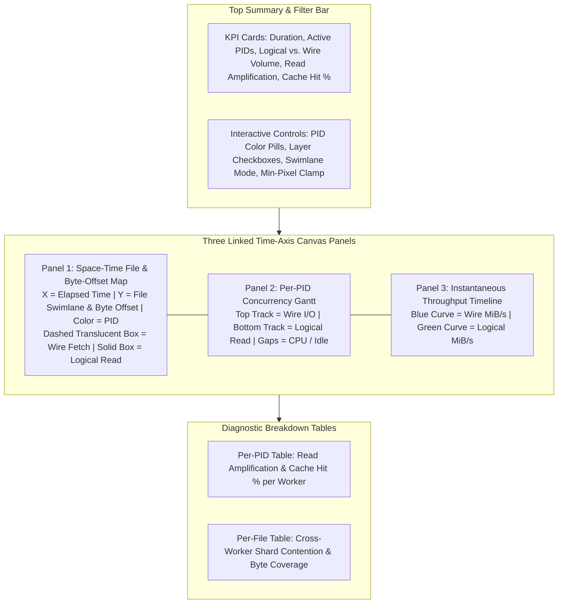

# User Guide: Multi-Process I/O Pattern Tracer and Visualizer

This guide explains how to instrument Python storage workloads, generate standalone interactive HTML traces, and interpret the resulting space-time visualizations using [io_tracer.py](file:///home/princer_google_com/c1dev/gcsfs/gcsfs/tests/perf/_common/io_vis/io_tracer.py) and [demo_hf_dataloader.py](file:///home/princer_google_com/c1dev/gcsfs/gcsfs/tests/perf/_common/io_vis/demo_hf_dataloader.py). We start with an overview of how the tracer captures logical and wire reads across worker processes, followed by a step-by-step walkthrough of the visual panels and diagnostic patterns, after which we provide configuration recipes and reference commands. Kernel-level network packet inspection and server-side Cloud Monitoring metric scraping are out of scope for this guide.

## Overview and Core Concepts

When debugging throughput bottlenecks in machine learning data loaders or checkpoint restoration jobs, aggregate megabytes-per-second numbers rarely reveal the root cause. A workload might be slow because worker processes are redundantly reading the same file headers, because a five-megabyte read-ahead buffer is being discarded after every small column read, or because workers spend most of their wall-clock time idle between batches.

To make these bottlenecks visible, our tracer records two distinct layers of file activity across every process in the workload, similar to comparing application system calls against operating system page-cache fetches. We call the byte ranges requested by the application or parser logical reads, and the actual byte ranges fetched over the network or storage client wire fetches.

For example, when PyArrow opens a Parquet shard to read a single column chunk of 326 kilobytes, that request is recorded as a logical read. If the underlying buffered file handle in [core.py](file:///home/princer_google_com/c1dev/gcsfs/gcsfs/core.py) is configured with a one-megabyte block cache, the cache miss triggers a one-megabyte range request to storage, which is recorded as a wire fetch. If PyArrow subsequently reads a 141-byte label column that falls within that same one-megabyte cached block, the tracer records a logical read marked as a buffer cache hit with zero accompanying wire traffic.

## Reading the Interactive Dashboard

When you open a generated trace such as [hf_dataloader_io_trace.html](file:///home/princer_google_com/c1dev/gcsfs/hf_dataloader_io_trace.html) in a web browser, the dashboard presents a top summary bar, interactive filter controls, three time-synchronized visual panels, and two breakdown tables.



### Summary Metrics and Filter Controls

The top row of cards summarizes six key workload health indicators:

* Trace duration and total event count across all processes.
* Active process count and total corpus size across all accessed files.
* Total logical bytes requested by the caller and the number of read calls.
* Total wire bytes fetched from storage and the number of range requests.
* Read amplification ratio, defined as wire bytes divided by logical bytes. Values near 1.00x appear in green, moderate amplification between 1.15x and 1.75x appears in yellow, and high amplification above 1.75x appears in red.
* Buffer cache hit rate, showing the percentage of logical read operations satisfied entirely from memory without triggering a wire fetch.

Directly below the summary cards, the control bar lets you isolate specific slices of the workload:

* Clicking any colored process pill toggles that process on or off across all charts, making it easy to inspect a single worker in isolation.
* Toggling the layer checkboxes lets you view wire fetches alone, logical reads alone, or only logical reads that resulted in a cache miss.
* Switching the vertical axis selector changes Panel 1 between normalized per-file swimlanes, a global cumulative byte offset view proportional to file sizes, or a full-height deep dive into a single file shard.
* Toggling the minimum pixel visibility checkbox clamps tiny reads to at least 3 pixels tall and 2.5 pixels wide so brief metadata reads remain visible when viewing the entire trace. Unchecking this option renders all boxes at their exact proportional byte height and microsecond width when zoomed in.

### Panel 1: Space-Time File and Byte-Offset Map

Panel 1 plots elapsed time from left to right on the horizontal axis and file byte offsets from bottom to top on the vertical axis. Each file shard occupies a horizontal swimlane where the bottom border represents byte offset zero and the top border represents the end of the file.

Every I/O operation appears as a rectangle colored according to the process identifier that executed it. Wire fetches are drawn as translucent rectangles with a dashed border, while logical reads are drawn on top as solid opaque rectangles. Hovering your cursor over any rectangle opens an inspection card showing the exact process identifier, thread name, layer, cache hit status, byte offset, byte length, duration in milliseconds, and effective bandwidth.

To zoom into a specific time window and byte range, click and drag a selection box diagonally across the canvas. You can also scroll your mouse wheel to zoom the time axis centered on your cursor, or click the reset button in the top right corner to return to the full trace.

### Panel 2: Per-PID Activity Timeline

Panel 2 assigns one horizontal row to each active process identifier, sharing the exact same horizontal time axis as Panel 1. Within each process row, the upper half displays wire fetches and the lower half displays logical reads.

This view separates storage latency from CPU processing. If a worker row shows a solid block of wire activity followed by a wide empty gap before the next read, that gap represents time spent outside storage—such as PyArrow decompression, tensor formatting, inter-process queue waits, or GPU training step execution. It also makes worker startup skew obvious when forked or spawned workers begin their first read seconds after the main process finishes dataset initialization.

### Panel 3: Instantaneous Throughput and Breakdown Tables

Panel 3 plots aggregate throughput over time in megabytes per second, contrasting wire bandwidth in blue against logical consumption bandwidth in green. Beneath Panel 3, two diagnostic tables summarize metrics per process and per file. In the per-file table, the process badges column lists every process identifier that read from each shard, allowing you to immediately spot shards that were redundantly opened by multiple workers.

## Common Diagnostic Patterns to Look For

When inspecting a new workload trace, four visual signatures account for the majority of storage inefficiencies:

* Unfilled translucent wire boxes indicate read amplification and wasted prefetching. When a tall translucent dashed rectangle contains only a small solid sliver inside it, the buffered file wrapper fetched a large read-ahead block that the caller never consumed before seeking away or closing the file. Reducing the block size or switching from eager read-ahead to on-demand range reads eliminates the excess transfer.
* Thin bars clustered along the top edge of every file swimlane represent repeated footer seeks. Columnar formats like Parquet store schema and row-group metadata in the final 64 kilobytes of the file. If you see every worker process reading the top edge of the same shard repeatedly across time, the loader is opening a fresh file handle for each row group instead of reusing an open reader or passing pre-parsed metadata from the coordinator process.
* Multi-colored boxes overlapping at the same vertical offset inside a single file swimlane indicate redundant cross-worker reads. In a well-partitioned data loader, each shard or row group should be painted in a single worker color. Seeing four different worker colors stacked on the same byte range means shard splitting or node partitioning is misconfigured.
* A dense vertical wall of tiny solid boxes without a surrounding translucent wire box indicates uncoalesced small reads. When cache type is set to none or raw unbuffered reads are used, thousands of small logical requests translate directly into thousands of individual network round-trips, causing high time-to-first-byte overhead and low aggregate bandwidth.

## Configuration Parameters

When tracing local datasets without a live Google Cloud Storage bucket, the tracer in [io_tracer.py](file:///home/princer_google_com/c1dev/gcsfs/gcsfs/tests/perf/_common/io_vis/io_tracer.py) can wrap local dataset files in an in-memory buffered file implementation so that local runs reproduce the exact two-layer caching behavior of remote object storage.

| Parameter | Description | Default Value |
| :--- | :--- | :--- |
| output_html | Destination file path for the generated standalone HTML dashboard | io_trace.html |
| title | Header title displayed at the top of the dashboard | Workload I/O Pattern Trace |
| local_block_size | Block size in bytes used to simulate wire range fetches on local files (set to 0 to disable) | 524,288 (512 KiB) |
| local_cache_type | Buffering policy for local simulation (readahead, blockcache, bytes, or none) | readahead |
| simulated_wire_latency_ms | Artificial sleep in milliseconds added to each simulated local wire fetch | 1.5 ms |
| keep_raw_events | Optional path to save the merged raw JSON Lines event log for offline scripting | None |

## Usage Examples and Reference Commands

You can run the bundled HuggingFace streaming benchmark demo from the repository root, or wrap any custom Python workload using the context manager in [io_tracer.py](file:///home/princer_google_com/c1dev/gcsfs/gcsfs/tests/perf/_common/io_vis/io_tracer.py).

```bash
# 1. Run the HuggingFace streaming DataLoader demo with 4 workers and 1 MiB blockcache
/home/princer_google_com/c1dev/gcsfs/.venv/bin/python \
  /home/princer_google_com/c1dev/gcsfs/gcsfs/tests/perf/_common/io_vis/demo_hf_dataloader.py \
  --num-shards 4 \
  --num-workers 4 \
  --batch-size 64 \
  --block-size 1048576 \
  --cache-type blockcache \
  --output /home/princer_google_com/c1dev/gcsfs/hf_dataloader_io_trace.html

# 2. Run against an existing gs:// bucket prefix containing shard_*.parquet
/home/princer_google_com/c1dev/gcsfs/.venv/bin/python \
  /home/princer_google_com/c1dev/gcsfs/gcsfs/tests/perf/_common/io_vis/demo_hf_dataloader.py \
  --prefix gs://your-bucket-name/dataset-prefix \
  --num-workers 4 \
  --output /home/princer_google_com/c1dev/gcsfs/hf_gcs_trace.html

# 3. Serve the generated HTML file over HTTP for viewing in your local browser
python3 -m http.server 8765 --directory /home/princer_google_com/c1dev/gcsfs
# Then open: http://localhost:8765/hf_dataloader_io_trace.html
```

To trace your own custom data-loading or checkpointing script in Python:

```python
from gcsfs.tests.perf._common.io_vis.io_tracer import trace_io

with trace_io(
    output_html="my_workload_trace.html",
    title="Custom Checkpoint Restore Trace",
    local_block_size=5 * 1024 * 1024,
    local_cache_type="readahead",
) as events:
    run_my_workload()
```
